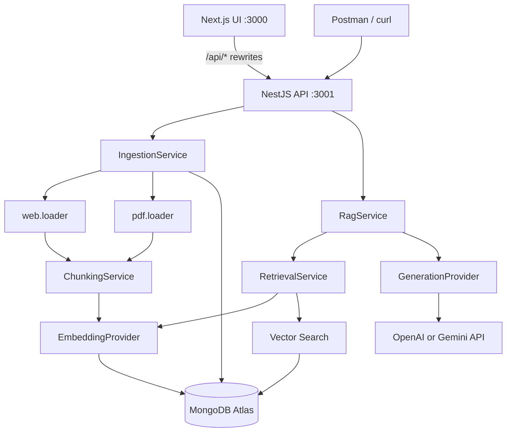

# Architecture

## System context

Domain logic lives in `packages/core`. HTTP adapters: `apps/api` (Nest), `apps/web` (Next).

## Trust boundaries

- **Public:** Browser and HTTP clients send URLs, PDFs, and questions to the UI or API.
- **Private server:** API keys, `MONGODB_URI`, embedding/generation calls, and full chunk text in logs (logging avoids secrets and full document bodies by default).
- **Untrusted data:** Fetched HTML, PDF text, and retrieved chunks are treated as untrusted reference material in LLM prompts.

## Component responsibilities

| Component | Role |
|-----------|------|
| `apps/api/src/*` | Nest controllers, filters, middleware |
| `packages/core/src/services/*` | Ingestion, retrieval, RAG orchestration |
| `packages/core/src/providers/*` | Swappable OpenAI / Gemini adapters |
| `packages/core/src/db/repositories/*` | Persistence and vector search |
| `packages/core/src/loaders/*` | URL fetch with SSRF checks, PDF parse |
| `packages/core/src/config/env.ts` | Validated configuration at startup |
| `apps/web/src/*` | Next.js UI (ingest, list, chat) |

## Ingestion flow

1. Validate URL or PDF.
2. Extract and normalize text (page metadata for PDFs).
3. Split with configurable size/overlap.
4. Batch-embed chunks; validate vector dimensions.
5. Insert chunks; update `rag_documents` status.
6. On failure, delete partial chunks and mark document `failed`.

## Query flow

1. Validate question and optional `documentIds` filter.
2. Embed question with the **same** embedding model as stored chunks.
3. Run Atlas `$vectorSearch` (optional filter on `documentId`).
4. Build bounded context from top chunks.
5. If no chunks, return explicit no-context message.
6. Otherwise call generation provider with grounding instructions and return answer + source metadata.

## Provider defaults

See [`.env.example`](../.env.example): Gemini `gemini-embedding-001` (768 dims) and a current Gemini flash model for generation.

OpenAI can be selected independently via `EMBEDDING_PROVIDER` / `GENERATION_PROVIDER`. Do not mix embedding models in one index without re-embedding.
