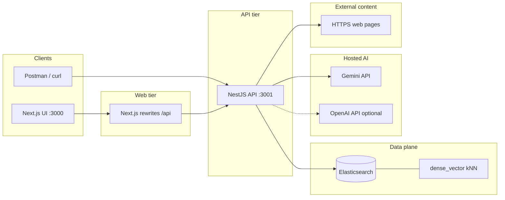
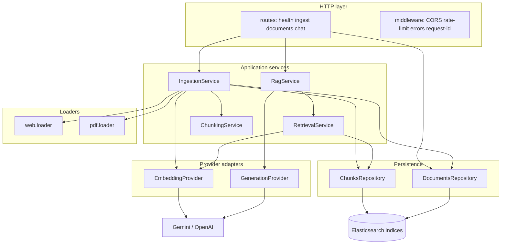
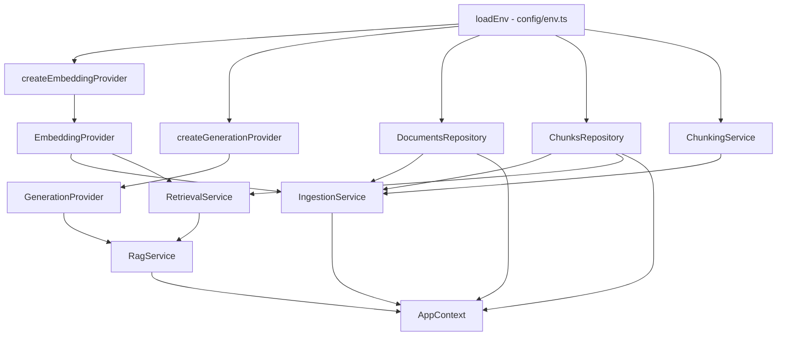
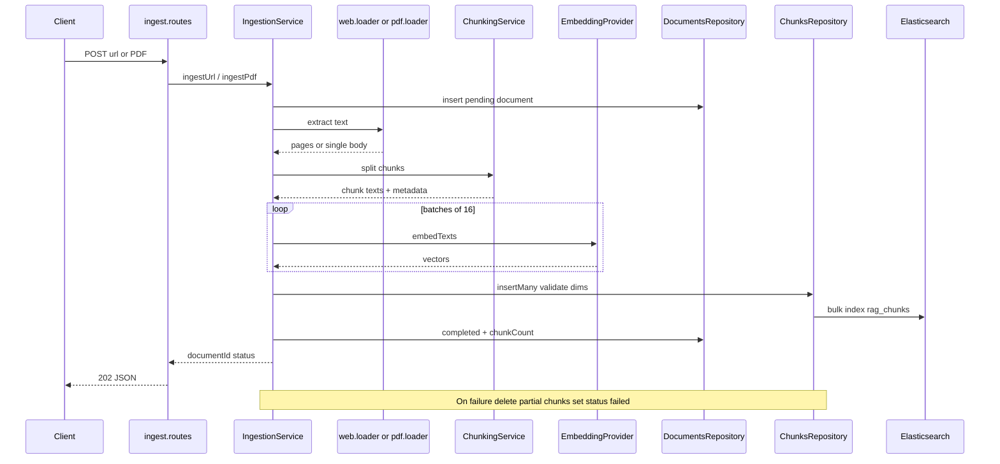
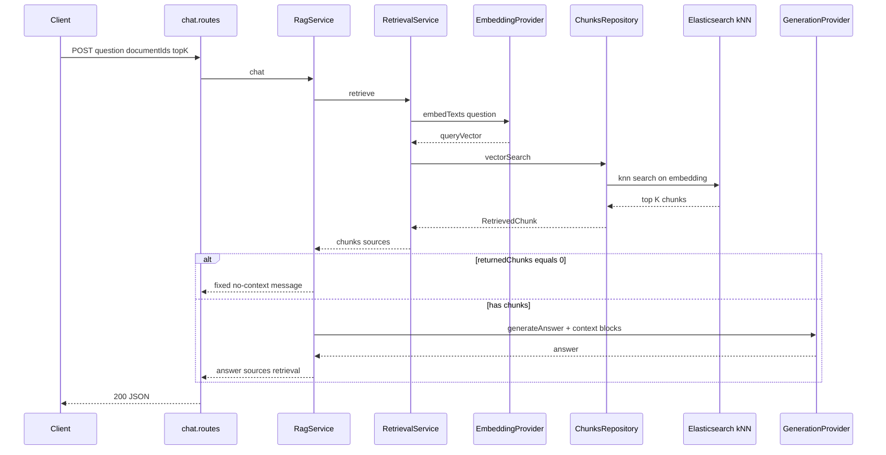
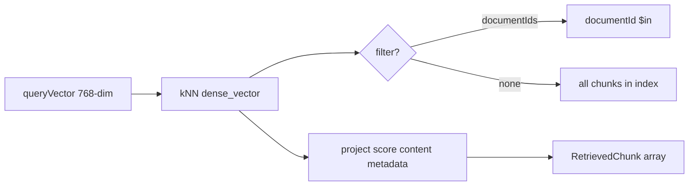
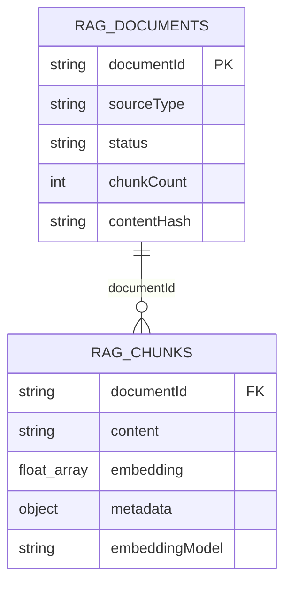

# RAG Application — Architecture and Implementation Guide

## 1. Purpose

This application implements Retrieval-Augmented Generation (RAG) over user-provided web pages and PDF documents. It uses a Node.js/TypeScript backend, **Elasticsearch** (Elastic Cloud) for vector retrieval, and hosted AI APIs (Gemini by default, OpenAI optional) for embeddings and answer generation.

RAG grounds a language model's response in retrieved source material. It does not guarantee correctness; source quality, retrieval quality, prompt design, and model behavior still matter.

## 2. High-level design (HLD)

HLD describes **what** the system does and **which major parts** interact, without file-level detail. A complementary diagram lives in [architecture.md](./architecture.md).

### 2.1 System context

External actors and systems:



| Boundary | Trust |
|----------|--------|
| Client → API | Untrusted input (URLs, PDFs, questions) |
| API → web | Untrusted HTML; SSRF controls apply |
| API → Elasticsearch | Private credentials; full chunk text stored |
| API → AI providers | Private API keys; prompts include retrieved text |

### 2.2 Container view (major subsystems)



### 2.3 Data flow summary

| Flow | Path |
|------|------|
| **Ingest** | Client → validate → load text → chunk → embed → write `rag_documents` + `rag_chunks` |
| **Chat** | Client → embed question → vector search → build context → generate answer + cite sources |
| **Delete** | Client → remove document row + all chunks for `documentId` |

## 3. Low-level design (LLD)

LLD maps **modules, sequences, and persistence** to the codebase (`src/`).

### 3.1 Module dependency (composition root)

Wiring is centralized in `createAppContext` (`src/app-context.ts`):



### 3.2 HTTP routing map

```mermaid
flowchart LR
    App[createApp - app.ts]

    App --> H[/health /ready]
    App --> I[/api/ingest/url POST]
    App --> P[/api/ingest/pdf POST]
    App --> S[/api/ingest/:id/status GET]
    App --> D[/api/documents GET DELETE]
    App --> C[/api/chat POST]

    I --> IngestSvc[IngestionService]
    P --> IngestSvc
    S --> IngestSvc
    D --> DocRepo[DocumentsRepository]
    C --> RagSvc[RagService]
```

| Route | Schema / input | Service |
|-------|----------------|---------|
| `POST /api/ingest/url` | `ingestUrlSchema` | `ingestUrl` |
| `POST /api/ingest/pdf` | multer `file` | `ingestPdf` |
| `POST /api/chat` | `chatRequestSchema` | `chat` |

### 3.3 Sequence — URL / PDF ingestion



### 3.4 Sequence — chat (RAG)



### 3.5 Vector search pipeline (repository)

Implemented in `ChunksRepository.vectorSearch`:



Index mapping must match `ELASTICSEARCH_CHUNKS_INDEX`, field `embedding`, and `EMBEDDING_DIMENSIONS` — see [elastic-chunks-mapping.json](./elastic-chunks-mapping.json).

### 3.6 Entity relationship (logical)



## 4. Main components

| Component | Responsibility | Implementation file(s) |
|-----------|----------------|------------------------|
| HTTP API | Routes, validation, contracts | `src/app.ts`, `src/routes/*.ts`, `src/schemas/*.ts` |
| Ingestion service | URL/PDF orchestration, status | `src/services/ingestion.service.ts` |
| Web loader | Safe fetch + HTML text | `src/loaders/web.loader.ts`, `src/utils/url-safety.ts` |
| PDF loader | Validate + extract pages | `src/loaders/pdf.loader.ts` |
| Chunking | Split text, preserve metadata | `src/services/chunking.service.ts` |
| Embedding provider | Hosted embeddings | `src/providers/embeddings/*` |
| Elasticsearch repository | Persist + kNN search | `packages/core/src/db/repositories/*.ts` |
| Retrieval service | Query embed + search | `src/services/retrieval.service.ts` |
| Generation provider | Grounded answers | `src/providers/generation/*` |
| Configuration | Env validation | `src/config/env.ts` |
| Tests | Unit tests (mocked) | `tests/*.test.ts` |

## 5. Document ingestion lifecycle

Implemented in `IngestionService`:

1. Client submits URL or PDF.
2. Loader extracts text; URL path applies SSRF checks (DNS + redirect validation).
3. `ChunkingService` splits text with `CHUNK_SIZE` / `CHUNK_OVERLAP`.
4. `EmbeddingProvider` embeds chunks in batches of 16.
5. `ChunksRepository` validates dimensions and inserts into `rag_chunks`.
6. `rag_documents` moves `pending` → `processing` → `completed` or `failed`.
7. Duplicate canonical URL or PDF hash returns existing completed document when found.

On failure, partial chunks are deleted before status is set to `failed` (compensation pattern in `ingestion.service.ts`).

## 6. Question-answering lifecycle

Implemented in `RagService` + `RetrievalService`:

1. `POST /api/chat` validates body via Zod.
2. Question is embedded with the configured embedding provider.
3. kNN search runs on `rag_chunks` (see `chunks.repository.ts`).
4. Context is built with `MAX_CONTEXT_CHARS` cap.
5. If zero chunks, a fixed message is returned **without** calling the LLM.
6. Otherwise `GenerationProvider` receives grounding instructions from `prompts.ts`.

## 7. Elasticsearch data model

### `rag_documents`

- `documentId`, `sourceType`, `sourceUrl`, `title`, `status`, `chunkCount`, `contentHash`, `errorSummary`, `createdAt`, `updatedAt`

### `rag_chunks`

- `documentId`, `content`, `embedding` (number[]), `metadata` (sourceType, sourceUrl, title, chunkIndex, pageNumber)
- `embeddingProvider`, `embeddingModel`, `embeddingDimensions`, `createdAt`

## 8. Chunks index (vector field)

Default Gemini configuration:

- Index: `rag_chunks` (`ELASTICSEARCH_CHUNKS_INDEX`)
- Field: `embedding` (`dense_vector`)
- Dimensions: **768** (`EMBEDDING_DIMENSIONS`)
- Similarity: cosine
- Filter: `documentId` keyword (used when chat passes `documentIds`)

Mappings: [elastic-chunks-mapping.json](./elastic-chunks-mapping.json). Setup: [elastic-cloud-setup.md](./elastic-cloud-setup.md).

**Indices and vector mapping** are created by `npm run ensure-indexes` when connected to Elasticsearch.

## 9. Provider abstraction

- `createEmbeddingProvider` / `createGenerationProvider` in `src/providers/*/index.ts`
- Env: `EMBEDDING_PROVIDER`, `GENERATION_PROVIDER` (`openai` | `gemini`)
- API keys validated conditionally in `src/config/env.ts`

Default models (`.env.example`):

- Embedding: `gemini-embedding-001` (768 dims via `outputDimensionality`)
- Generation: `gemini-3.5-flash-lite` (use a current Gemini flash model for your API key)

## 10. Security and privacy

| Control | Implementation |
|---------|----------------|
| Secrets server-only | Keys only in env; `.env` gitignored |
| SSRF | `url-safety.ts` + manual redirect handling in `web.loader.ts` |
| PDF limits | Magic bytes, `MAX_PDF_SIZE_MB`, multer limit |
| Rate limiting | `express-rate-limit` |
| CORS | Explicit `CORS_ORIGINS` list |
| Request IDs | `x-request-id` middleware |
| Logging | Pino; redacts authorization header |
| Deletion | `DELETE /api/documents/:id` removes chunks + document |

**Limitation:** Redirect targets are validated per hop, but URL ingestion should not be exposed to untrusted users without additional network controls.

## 11. API reference

See [api.md](./api.md).

## 12. Configuration and setup

Copy `.env.example` to `.env` and set at minimum:

- `ELASTICSEARCH_URL` and `ELASTICSEARCH_API_KEY`
- `GEMINI_API_KEY` (for default providers)
- `EMBEDDING_MODEL=gemini-embedding-001` and `EMBEDDING_DIMENSIONS=768`

## 13. Testing and validation

Commands (Node 20+):

```bash
npm install
npm run typecheck
npm test
npm run build
```

- **Unit tests:** mocked providers/DB where needed — no live Elasticsearch or API keys required.
- **Integration:** Not automated; use Elastic Cloud + keys locally after `ensure-indexes`.

## 14. Operational considerations

- Synchronous ingestion may hit `REQUEST_TIMEOUT_MS` on large PDFs.
- Changing embedding model requires new index dimensions and full re-ingest.
- OCR and hybrid search are out of scope.

## 15. Implementation record

| Item | Value |
|------|--------|
| Package manager | npm |
| Node | >= 20 (engines in `package.json`) |
| Embedding default | Gemini `gemini-embedding-001`, 768 dimensions |
| Generation default | Gemini `gemini-3.5-flash-lite` (verify against your API key) |
| Database | Elasticsearch indices `rag_documents`, `rag_chunks` |
| Vector search | kNN on `embedding` in chunks index |
| Endpoints | `/health`, `/ready`, `/api/ingest/*`, `/api/documents`, `/api/chat` |
| Manual setup | Elastic Cloud deployment, API key, `.env`, `npm run ensure-indexes` |
